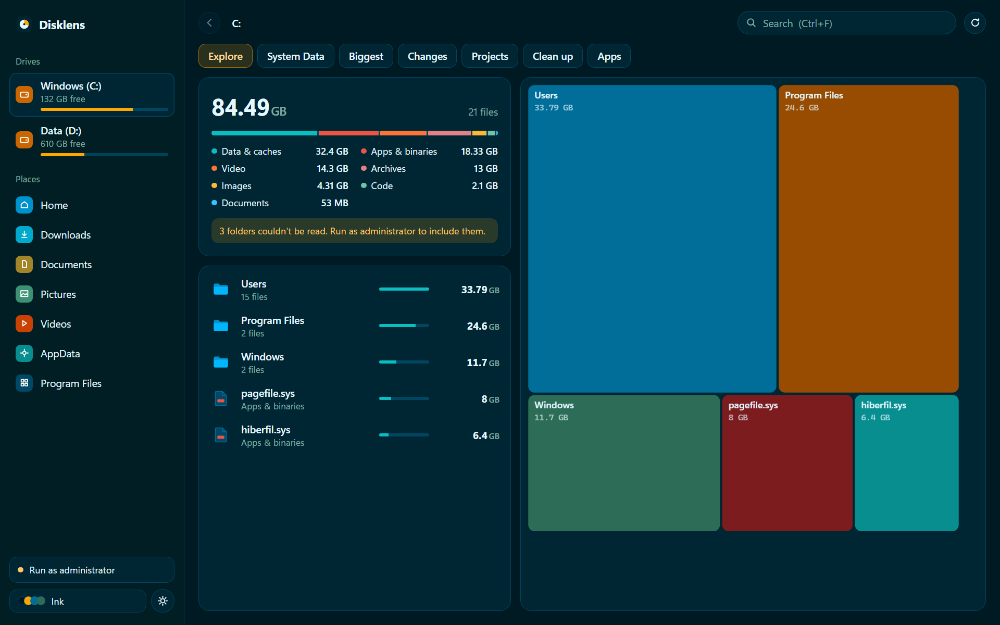
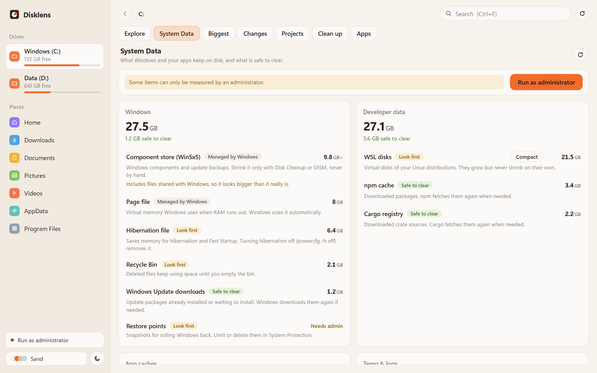
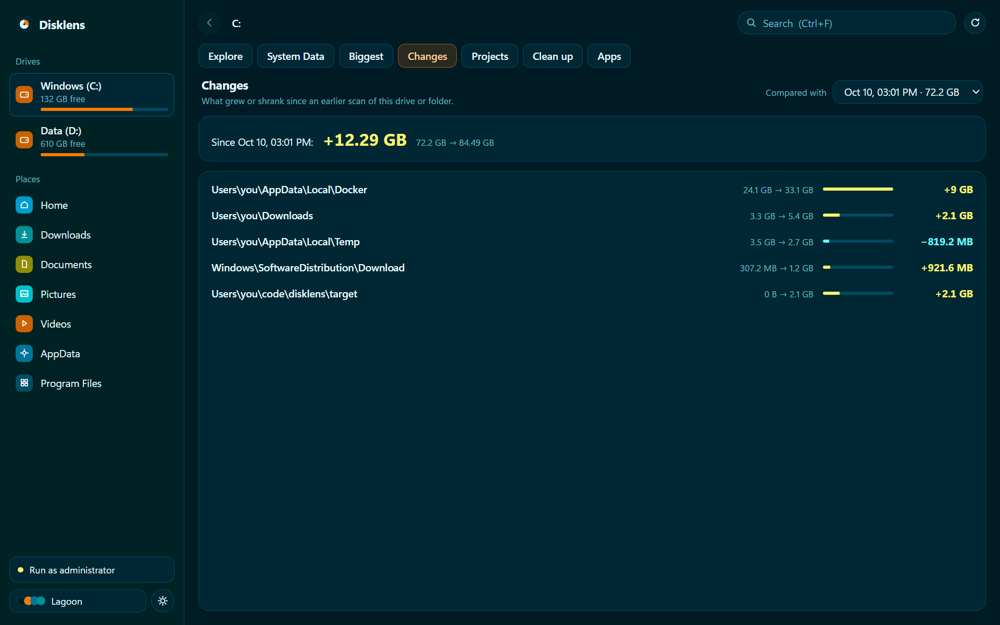
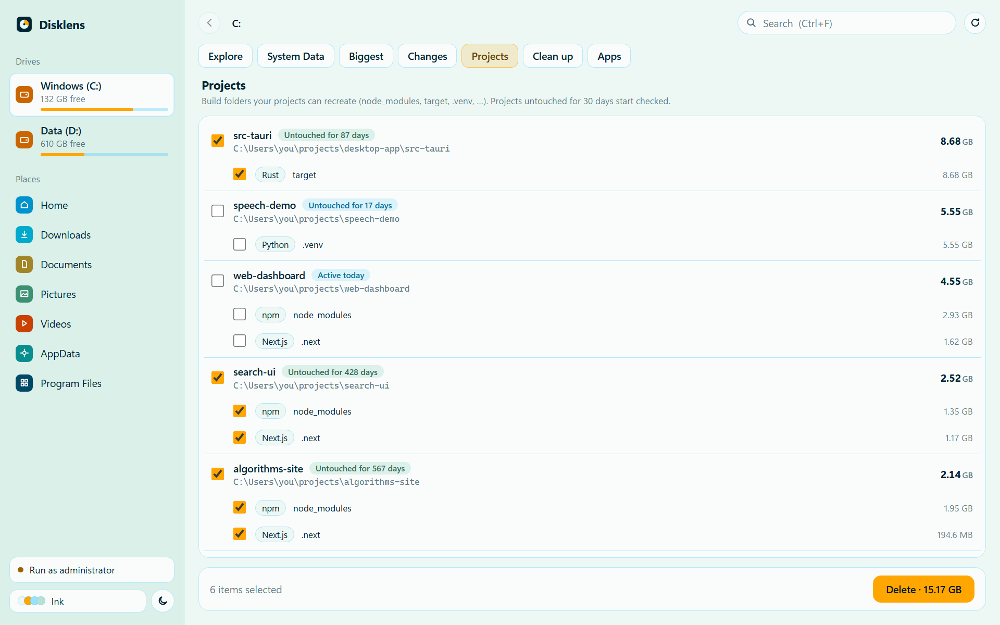
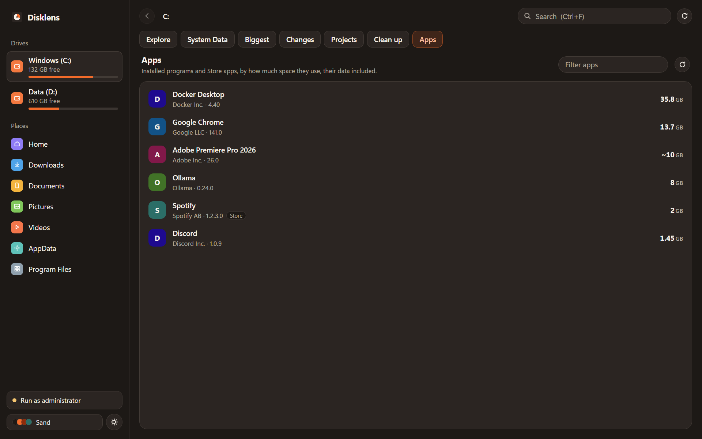

# Disklens

**See where your Windows disk space went, and clean it up safely.**

[](https://github.com/arielff3/disklens/actions/workflows/ci.yml)
[](LICENSE)


Disklens scans a drive or folder, shows what is using the space, explains what Windows and your apps keep on disk, and helps you clear what is safe to clear. Everything runs on your PC: no account, no telemetry, nothing is uploaded.



Inspired by [Diskzy](https://diskzy.app) for macOS. Disklens is an independent project, not affiliated with Diskzy.

## Features

- **Explore.** Sizes on disk for every folder, a breakdown by file type, and a treemap. Scans are saved, open instantly next time, and stay up to date while you work.
- **System Data.** The Windows equivalent of the gray "System Data" bar: page file, hibernation, WinSxS, Windows Update downloads, restore points, browser and app caches, developer caches, WSL and Docker disks. Each item says whether it is *safe to clear*, worth a *look first*, or *managed by Windows*.
  - **Compact WSL and Docker disks**: their virtual disks grow but never shrink on their own.
  - **Windows tools**: turn off hibernation, clean up components (DISM), compress Windows files (CompactOS), open restore point and page file settings.
- **Biggest and Search.** The largest files, and an instant search with filters: `ext:iso size:>1gb age:>1y in:downloads kind:video "exact words"`.
- **Changes.** What grew or shrank since an earlier scan, down to the folders that explain it.
- **Projects.** `node_modules`, Rust `target`, Gradle `build`, .NET `bin`/`obj`, Python `.venv`, `.next` across your projects, with how long each project has been untouched.
- **Clean up.** Safe-to-clear caches and temp folders in one checklist; apps that are open are left alone.
- **Apps.** Installed programs and Store apps by footprint, data folders included. Uninstall with the app's own uninstaller, then remove what it left behind.
- **Themes.** Sand, Ink and Lagoon, each in light and dark.

| System Data | Changes |
|---|---|
|  |  |
| **Projects** | **Apps** |
|  |  |

## Safety

Disklens deletes things, so it is careful about it:

- **Clean up and app leftovers go to the Recycle Bin.** Windows asks before deleting anything too big for the bin.
- **Projects deletes permanently**, because build folders are recreated by `npm install`, `cargo build` and friends. You confirm the exact list of folders first.
- **Protected folders are never touched**: drive roots, Windows, Program Files, ProgramData, your user folder, AppData, Documents, Desktop, Downloads, Pictures, Videos and Music, and any folder that contains them.
- **Junctions and symbolic links are never followed**, so shared stores (pnpm, for example) stay intact.
- **Open apps are skipped**: a browser cache is not cleared while the browser runs.
- **Only what was shown can be deleted**: the backend refuses paths it did not offer you.
- Windows-level changes (hibernation, DISM, CompactOS, disk compaction) use Windows' own tools and ask for administrator permission each time.

## Install

Download the installer from [Releases](https://github.com/arielff3/disklens/releases). Windows 10 or 11, 64-bit.

The installer is not code-signed yet, so Windows SmartScreen may warn you: choose **More info → Run anyway**.

Disklens runs without administrator rights. A few items (restore points, Windows' temp folder, the real WinSxS size) can only be measured as administrator; **Run as administrator** at the bottom of the sidebar restarts it elevated.

## Build from source

Requirements: [Node.js](https://nodejs.org) 22+, [Rust](https://rustup.rs) (MSVC toolchain), Visual Studio Build Tools with the C++ workload, and WebView2 (included in Windows 11).

```bash
npm install
npm run tauri dev      # run in development
npm run tauri build    # build the installer (src-tauri/target/release/bundle)
```

Tests:

```bash
npm test
cd src-tauri && cargo test && cargo clippy --all-targets -- -D warnings
```

`npm run dev` alone opens the interface in a browser with sample data, which is handy for working on the UI. See [CONTRIBUTING.md](CONTRIBUTING.md) for more.

## How it works

- **Tauri 2** app: a Rust backend and a React + TypeScript interface.
- **Scanning**: a parallel directory walk builds an in-memory tree with sizes on disk, saved as a compressed snapshot and kept current by a file watcher.
- **System Data, Clean up, Apps, Projects**: independent Rust modules under `src-tauri/src/`, each with its own tests.

## License

[MIT](LICENSE)
